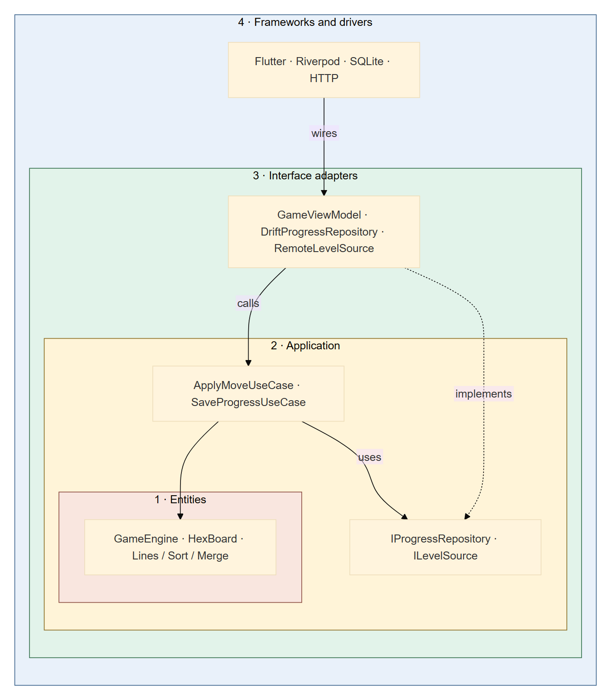
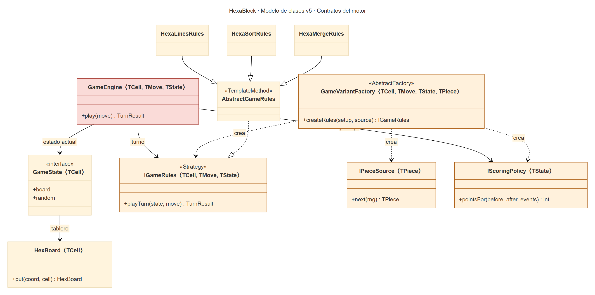
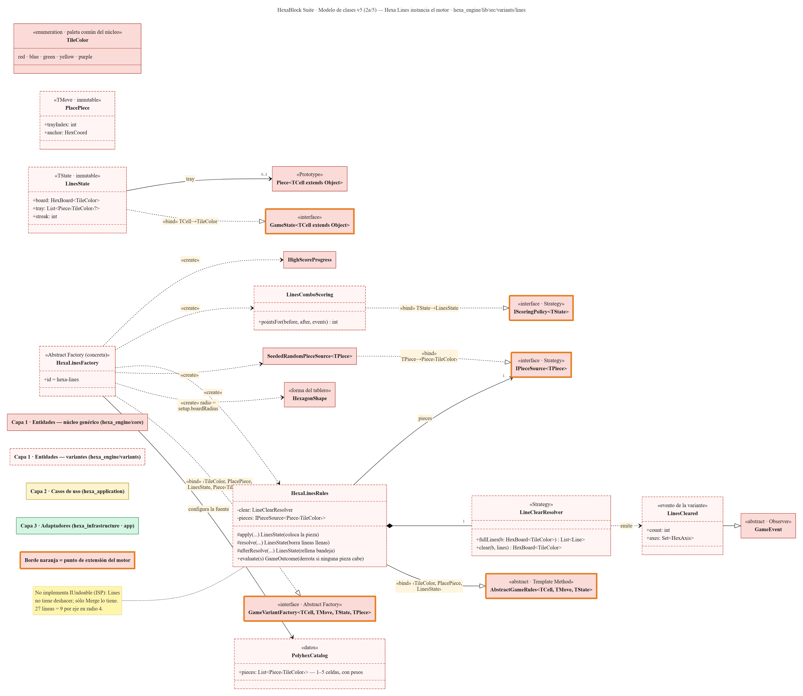
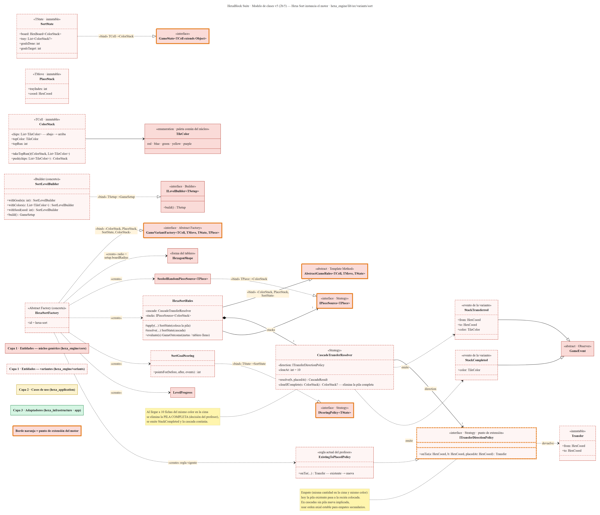
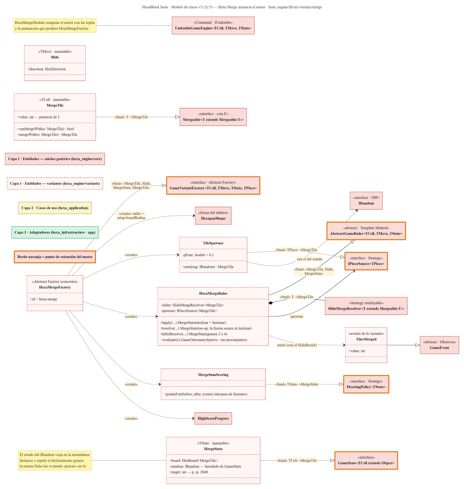
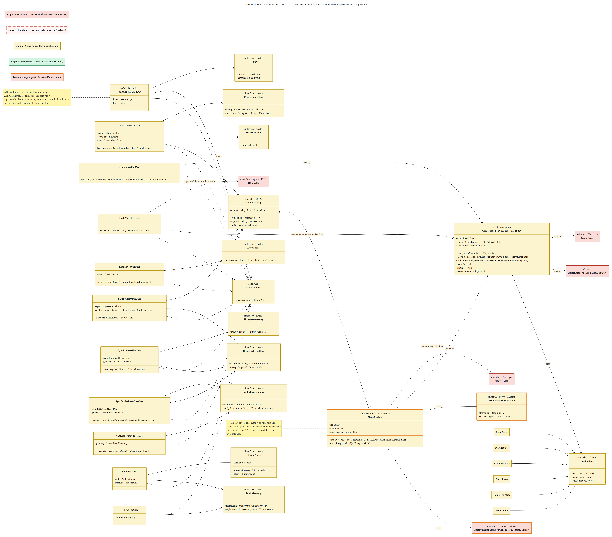
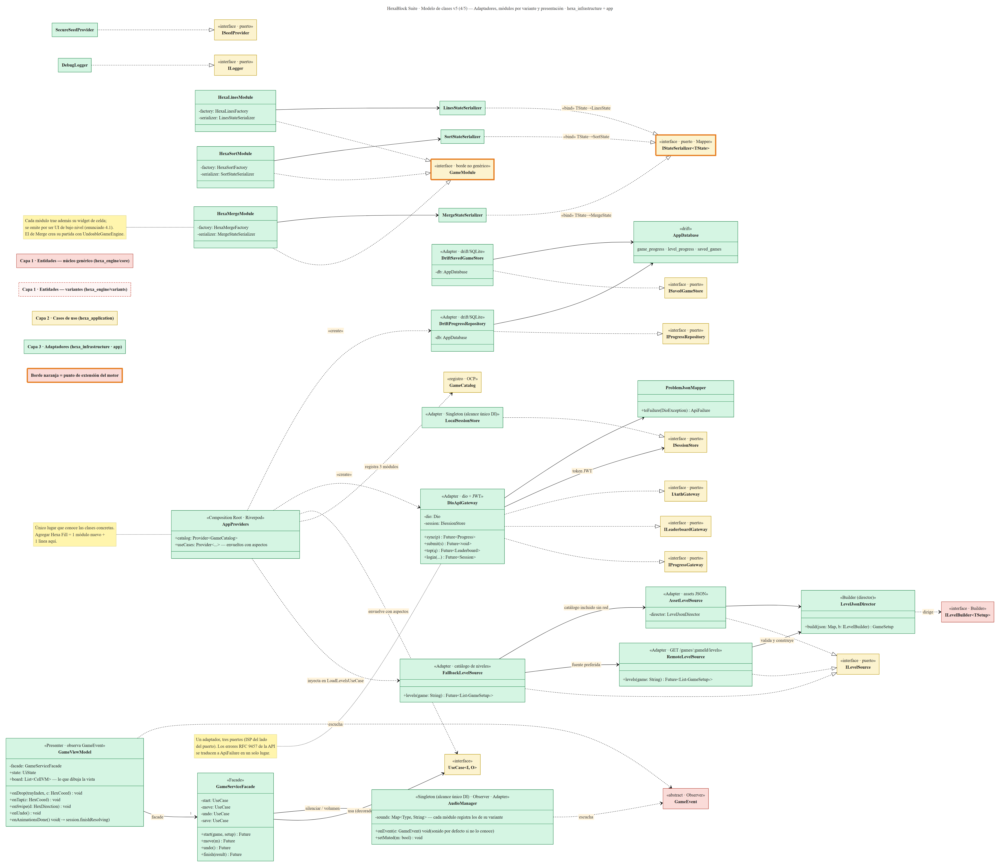
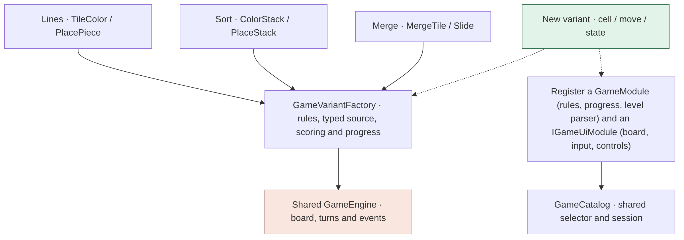

# HexaBlock Suite · mobile game


HexaBlock is a Flutter puzzle suite designed around one hexagonal board and turn engine. **Lines** clears rows on three axes, **Sort** transfers coloured chips between stacks, and **Merge** slides number tiles in six directions.

**Development status.** The game selector opens the Lines guide. Sort and Merge are listed as upcoming. Gameplay and settings are separate increments. [Assessment scope](docs/specs/requirements.md) · [Backend](https://github.com/hexablock-g5-ucab/hexablock-api)

## Getting started

Use Flutter stable with Dart 3.14 or a compatible later Dart 3 release, Node.js with npm for Git hooks, and an emulator or connected device. From the client checkout:

```sh
npm ci
flutter pub get
cd app
flutter run
```

## Architecture

The engine owns geometry and game rules. Application use cases coordinate sessions and declare ports. Adapters translate storage, network data and gestures. The Flutter app wires these components together.



[Editable source](docs/diagrams/clean-architecture.mmd)

## Generic engine

| Variant | Cell | Move | State | Piece source produces |
| --- | --- | --- | --- | --- |
| Lines | TileColor | PlacePiece | LinesState | `Piece<TileColor>` |
| Sort | ColorStack | PlaceStack | SortState | ColorStack |
| Merge | MergeTile | Slide | MergeState | MergeTile |

An absent board entry represents an empty cell, so `TCell extends Object`. The bound `TState extends GameState<TCell>` gives the engine access to its typed board. A fourth factory parameter, `TPiece`, ties the source to its rules. Only the slide resolver requires `T extends Mergeable<T>`. [Extension walkthrough](docs/EXTENSIBILITY.md)

## Class model

The complete client model in one picture (model v6.3): the four Clean Architecture layers, the generic engine and
the three variants. Colours mark the layer: red = Entities (`hexa_engine`, dashed border = variants),
yellow = Use cases (`hexa_application`), green = Interface adapters (`hexa_infrastructure`, `app`),
blue = Frameworks. An orange border marks an extension point.

[](docs/diagrams/class-diagram-app.svg)

Click the image for the zoomable SVG. Source: [`class-diagram-app.mmd`](docs/diagrams/class-diagram-app.mmd).
The backend model lives in [hexablock-api](https://github.com/hexablock-g5-ucab/hexablock-api#architecture-and-class-model).

The same model split by area, easier to read:

<details><summary>Core contract overview</summary>



[Editable overview](docs/diagrams/00-overview.mmd)

</details>

<details><summary>Engine and geometry in detail</summary>


[Editable source](docs/diagrams/01-core.mmd)

</details>

<details><summary>Hexa Lines</summary>



[Editable source](docs/diagrams/02a-lines.mmd)

</details>

<details><summary>Hexa Sort</summary>



[Editable source](docs/diagrams/02b-sort.mmd)

</details>

<details><summary>Hexa Merge</summary>



[Editable source](docs/diagrams/02c-merge.mmd)

</details>

<details><summary>Sessions, use cases and ports</summary>



[Editable source](docs/diagrams/03-application.mmd)

</details>

<details><summary>Adapters, modules and presentation</summary>



[Editable source](docs/diagrams/04-adapters.mmd)

</details>

[Design decisions and model index](docs/diagrams/README.md)



[Editable source](docs/diagrams/extensibility.mmd)

## Design patterns, SOLID and AOP

Abstract Factory assembles compatible families. Strategy selects rules and scoring. Template Method defines a common turn sequence. Observer distributes game events. Command records the last accepted Merge move. A Decorator around the use case records operation, outcome and duration. The [class views](docs/diagrams/README.md) identify the participants.

| Principle | Design example | Acceptance check |
| --- | --- | --- |
| SRP | HexGeometry owns traversal; LinesComboScoring owns points | Scoring changes independently of traversal |
| OCP | GameModule supplies a variant's collaborators | Register a test module against the existing engine |
| LSP | All rules observe the same turn contract | An invalid move preserves the snapshot and score |
| ISP | IUndoable is a capability of the Merge engine | Lines and Sort run without undo |
| DIP | LoadLevelsUseCase takes ILevelSource | Run the use case with an in-memory source |

The [engine architecture test](packages/hexa_engine/test/architecture_test.dart) currently checks dependency boundaries. Each implementation PR should link its source and executable evidence here.

### Application logging (NFR-006)

Every application operation can implement [UseCase](packages/hexa_application/lib/src/use_cases/use_case.dart).
At the composition root, wrap that operation once, for example:

```dart
final tracedMove = LoggingUseCase('apply_move', applyMove, logger);
await tracedMove.execute(request);
```

The [decorator](packages/hexa_application/lib/src/aspects/logging_use_case.dart) records entry, outcome
and elapsed milliseconds through an injected [ILogger](packages/hexa_application/lib/src/ports/logger.dart)
port. Each call returns a `Future<Result<O, AppFailure>>`. A returned `Failure` is logged as a
failed outcome and forwarded unchanged. Unexpected exceptions are logged by type and rethrown
with their original stack trace. Request values, results and exception messages
stay out of the log. The first gameplay use case can reuse this wrapper when wired into the app.
[Application tests](packages/hexa_application/test/logging_use_case_test.dart) exercise the public package API.

## Running tests

From the workspace root:

```sh
dart format --output=none --set-exit-if-changed .
flutter analyze
cd packages/hexa_engine
dart test
cd ../hexa_application
dart test
cd ../../app
flutter test
```

[CI](.github/workflows/ci.yml) also discovers package test directories. The [release workflow](.github/workflows/release.yml) builds an APK for version tags.

## AI usage, contributing and license

Record significant assistance in [AI_USAGE.md](AI_USAGE.md). Follow [CONTRIBUTING.md](CONTRIBUTING.md) for English Conventional Commits, branches, CI and review. [MIT license](LICENSE).
