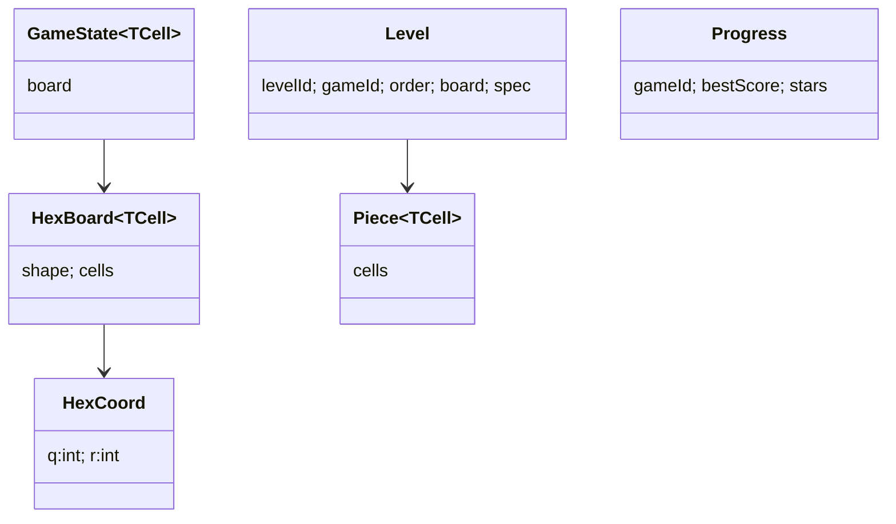

# Entity Model (glossary)

| Term | Meaning |
| --- | --- |
| Cell content (`TCell`) | What a cell holds: TileColor (Lines), PieceId (Fit), ColorStack (Sort), MergeTile (Merge) |
| Move (`TMove`) | PlacePiece, FitMove, PlaceStack, Slide |
| Tray | The pieces or stacks offered to the player |
| Line | All cells with the same q, r or s value (27 lines on a radius-4 board) |
| Top run | Consecutive chips of the same colour at the top of a stack |
